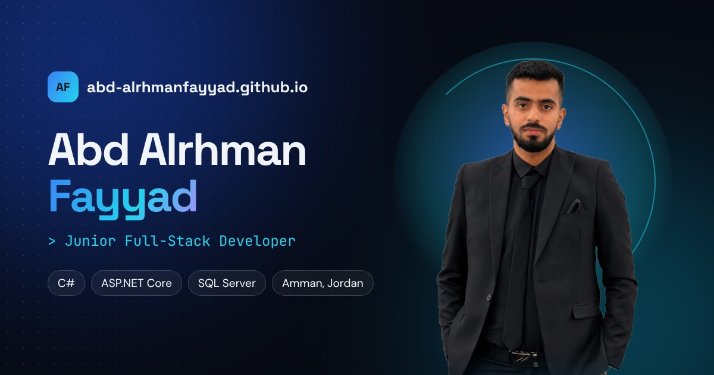

# Abd Alrhman Fayyad – Portfolio

My personal portfolio website: who I am, the projects I've built, my skills, my learning journey and how to contact me.

**Live website:** https://abd-alrhmanfayyad.github.io/portfolio-v2/



## Features

- Dark and light mode, saved in the browser
- Full Arabic version (right-to-left) with one button, also saved in the browser
- Projects slider with flip cards: the back of each card shows the problem, the solution, the stack and the links
- Every project shown on a laptop and phone mockup
- Hero with a starfield, a typing role line and floating badges
- Scroll animations, a scroll progress bar, a back-to-top button and a glowing cursor on desktop
- Real C# code from my School Management System
- Certificates section
- Contact form that sends messages to my email (FormSubmit)
- Link preview image for LinkedIn and WhatsApp, and a favicon
- Visitor stats with GoatCounter (no cookies)
- Responsive on phone, tablet and desktop, and respects "reduce motion"

## Built with

- HTML5
- CSS3 (Grid, Flexbox, custom properties, 3D transforms, keyframe animations)
- JavaScript (no frameworks)
- GitHub Pages

## Project structure

```
index.html
assets/
  css/style.css
  js/main.js
  img/        images, project screenshots, favicon, link preview
  files/      CV (PDF)
```

## Contact

- Email: abdalrhman.fayyad.dev@gmail.com
- LinkedIn: https://www.linkedin.com/in/abd-al-rhman-fayyad-78a7312b5
- GitHub: https://github.com/abd-alrhmanfayyad
